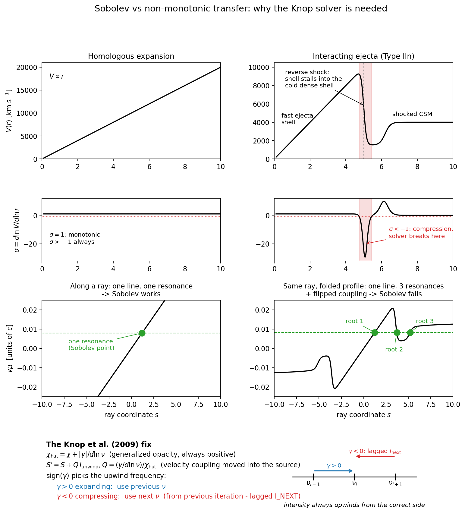
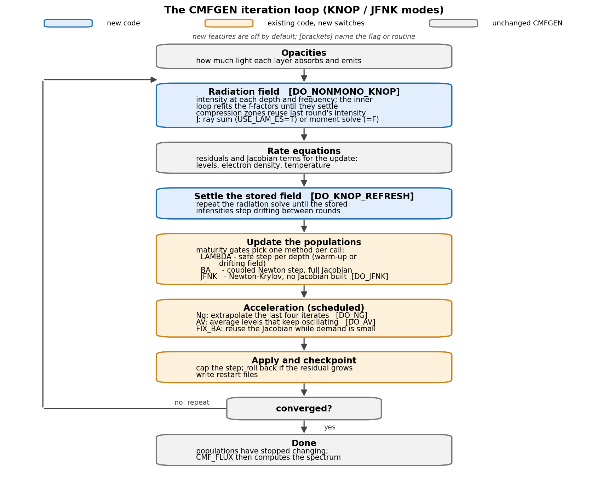

# CMFGEN jfnk: non-monotonic velocity fields + JFNK populations

Development branch of [CMFGEN](https://knowledge.ufa.international/hillier/cmfgen.html)
(baseline `cur_cmf_18jun25`, `pitt-phyast/cmfsource`) for supernova
ejecta where the velocity law `V(R)` is not monotonic. The case we
care about is a Type IIn: a fast ejecta shell hits slow, dense CSM,
and a reverse shock stalls the shell into a cold dense shell. There
`sigma = d ln V / d ln R` drops below -1, which stock CMFGEN assumes
cannot happen, so the transfer inside the compression zone returns
negative or NaN intensities.

The non-monotonic and JFNK solver paths are opt-in. With their flags
unset, those paths do not replace the stock solver. This tree also has
general correctness, build, and observation-frame fixes, so it is not a
byte-for-byte copy of upstream.

The private development repo is `Astro-Sean/cmfgen-nonmono` (CMFGEN is
licensed code - keep the repo private). `main` is both the GitHub default
and the development branch for this source, including JFNK. This checkout
pushes to `origin/main`. `upstream` is the pristine
`pitt-phyast/cmfsource`, used for fetching and diffing only.

## What the solver does



Regenerate with `python3 cmfgen_obsidian/plot_knop_solver.py`.

In a homologous flow each line meets a photon at exactly one point
per ray - the Sobolev point. When the velocity turns over, the same
line resonates at three points on one ray, and the term that couples
neighbouring frequencies changes sign inside the compression zone, so
the usual upwind scheme points the wrong way.

The solver follows Knop, Hauschildt & Baron (2009): the sign of the
coupling picks which side counts as upwind. Expanding points couple
to the previous frequency, compressing points to the next one. The
next frequency has not been computed yet on the downward sweep, so
its intensity is stored and lagged by one iteration (`I_NEXT`, kept
only where `sigma < -1`). This keeps the modified opacity positive
and removes the negative intensities.

## Iteration cycle



Regenerate with `python3 cmfgen_obsidian/plot_iteration_cycle.py`.

Each pass through the diagram is one CMFGEN iteration in a KNOP run
(`DO_NONMONO_KNOP=T`): solve the radiation field, update the
populations, write a checkpoint, repeat until the populations stop
changing. Grey boxes are stock CMFGEN, blue are new code, amber are
existing routines with new switches. Everything new is off by
default; the bracketed keys turn it on.

The new parts:

- `DO_NONMONO_KNOP` turns on the Knop solver. In compression zones a
  point's intensity couples to last iteration's `I_NEXT` instead of
  the next frequency.
- `DO_KNOP_REFRESH` re-solves the radiation field until the lagged
  values stop moving, so the populations are never updated against a
  stale field.
- `SOLVE_FOR_POPS` keeps the model on safe Lambda steps until the
  lagged field settles, then switches to the faster Newton step.
- `FGINEXT_GS` / `MOMJNXT_GS` checkpoint the lagged fields next to
  `POINT1/2`, so a restart picks up where it stopped.

## JFNK population solve

The stock update alternates Lambda iterations with a Newton step
(`SOLVEBA_V13`) built on the depth-block rate matrix. On a stalled
non-monotonic model that step overshoots: Lambda brings the largest
correction near 40 percent, then the first full step asks for order
1e7 percent. The JFNK path treats statistical equilibrium as
`F(n) = 0` and solves it with GMRES - finite-difference
Jacobian-vector products, the BA matrix as preconditioner only
(Knoll & Keyes 2004; Arramy et al. 2024).

- `USE_JFNK` (VADAT, default F): replaces the `SOLVEBA_V13` call on
  full iterations after `JFNK_WARMUP` (default 6); falls back to a
  Lambda-mode SOLVEBA on failure. Requires `DO_NONMONO_KNOP=T`;
  admission requires `USE_LAM_ES=T` - the MOM path has no evaluation
  freeze for its lagged `J_NEXT_FRQ`/`H_NEXT_FRQ` stores.
- `JFNK_COUPLED` (default F): each residual/JVP evaluation re-runs
  the continuum radiation sweep (`JFNK_RAD_SWEEP_V1`, registered via
  `JFNK_SWEEP_CB`) at the perturbed populations, so the
  finite-difference JVP probes `dJ/dn`. With `=F` the V6
  frozen-field residual (stored radiative term + `CMAT_RAD`
  linearization) is used for comparison only.
- `FREEZE_I_NEXT`: the lagged Knop `I_NEXT` store is held fixed for
  the duration of a JFNK evaluation, so trial residuals cannot
  mutate the radiation state.

Details and failure modes: `cmfgen_obsidian/solvers/JFNK_SOLVER.md`.
Combined-solver architecture: `cmfgen_obsidian/solvers/KNOP_JFNK.md`.
Audit: `cmfgen_obsidian/audits/JFNK_SOLVER_AUDIT.md`.

## Validation status

`USE_JFNK` remains off by default. Admission also waits for the warmup,
a mature and stable Knop field, and contracting BA demand; it is not
triggered by a single low correction. The frozen-J path has been exercised
as a `SOLVEBA_V13` replacement. The coupled path has not yet completed a
runtime-validated model activation, so a clean build or a generated spectrum
alone does not establish that JFNK converges or produces a valid SN 2024pba
spectrum. Check the dated run record in
`cmfgen_obsidian/history/convergence_issues.md` and the
solver status notes before interpreting results.

## Changes vs upstream

Solver behavior is gated where stated; the tree also contains general
correctness and build fixes that are not controlled by solver flags:

- `DO_NONMONO_SOB` (VADAT): applies the Sobolev line treatment in
  compression zones, after Dessart, Audit & Hillier (2015).
  `SIGMA_TRUE` is carried in `VADAT`/`RVTJ` and recomputed on restart.
- `DO_NONMONO_KNOP` (CMF_FLUX_PARAM): selects the Knop solver
  (`plane/fg_j_cmf_nonmono_v1.f`, `plane/mom_j_cmf_nonmono_v1.f`)
  with the `I_NEXT` machinery. The JFNK path freezes that store during
  residual evaluations.
- `USE_JFNK` / `JFNK_COUPLED` (VADAT): Jacobian-free Newton-Krylov
  population solve (`new_main/mod_subs/jfnk_*.f`) that replaces
  `SOLVEBA_V13` on admitted full iterations - see the JFNK section.
- BA residual acceptance: `DO_BA_RES_ACC` checks an armed BA step at
  the next residual measurement. `BA_REJ_FRAC` (default 0.25) allows
  rollback of only failed depth columns when the bulk `RES2` channel
  remains acceptable; a bulk failure or too many bad columns keeps the
  whole-state rollback. `BA_NREJ_LIM` (default 20) stops repeated
  rejected or degraded steps.
- Per-equation quarantine: `DO_BA_QUAR` (default F, requires
  `DO_BA_RES_ACC`) can park measured-failure equation/depth pairs, up
  to `BA_QUAR_MAX` (default 25). Lambda iterations still update those
  populations, and diagnostics report the parked equations. Held-population
  calls defer verdicts; residual-improving masked or soft-rejected steps
  do not burn the consecutive-rejection limit.
- KNOP field-stall controls include `GS_STATE` checkpoints,
  `KNOP_STALL_MAX` (default 60) watchdog in generated jobs,
  `GS_FREEZE_LIM` (default off) in-model stop, and `MOM_TRIAL_MIN`
  (default 30) marginal-release BA trials gated by `DO_BA_RES_ACC`.
  Accepted trials refund `N_FROZEN`; `GS_TRIAL_LIM` (default 15,
  <=0 disables the limit) bounds accepted trials between raw-mature
  sweeps and persists its count through `GS_STATE` across requeues.
- Invalid `DO_NONMONO_SOB` / `DO_NONMONO_KNOP` line-treatment
  combinations are rejected by the input readers instead of running
  with inconsistent transfer settings.
- General fixes include the non-monotonic observed-frame integration
  bounds in `obs/obs_frame_sub_v9`, the `NISO=-1` input handling in
  `subs/rd_sn_data.f`, and headless build support in `obs_template/`
  and `pgplot_stubs/`.

## Running it

### Pipeline runs

Prepare, validate, and submit SN 2024pba models through the pipeline
orchestrator, not by calling CMFGEN submission scripts or `sbatch`
directly:

```bash
python scripts/run_model_grid.py <config.yaml> [--epochs <day> ...]
```

Run this from the SN2024pba pipeline checkout that contains
`scripts/run_model_grid.py`. That orchestrator prepares the CMFGEN inputs,
selects the executable, and records run provenance. A spectrum produced
outside that path is not a pipeline-validated model result.

### Non-monotonic `cmf_flux` settings

For a KNOP non-monotonic OBS/`cmf_flux` stage, use a consistent set of
`CMF_FLUX_PARAM` keys. The pipeline writes:

| Key | Value |
|-----|-------|
| `DO_NONMONO_KNOP` | `T` |
| `N_TYPE` | `N_ON_J` |
| `GLOBAL_LINE` | `BLANK` (all `TRANS_* = BLANK`) |
| `FG_OPT` | `INT` or `INS` |
| `USE_LAM_ES` | `T` |
| `LAM_SET` | `F` |
| `DO_SOB_LINES` | `F` |
| `SOB_FREQ_IN_OBS` | `F` |

Notes:

- `USE_LAM_ES=T` is required for the OBS/`cmf_flux` stage and for JFNK
  admission. `=F` uses `MOM_J_CMF_NONMONO_V1` in the main run, but JFNK
  stays deferred because the MOM path has no evaluation freeze for its
  lagged `J_NEXT_FRQ` / `H_NEXT_FRQ` stores.
- After a requeue, `FGINEXT_GS` is remapped if the depth grid changed
  (checkpoint `VER=3`).

### Build

Use the production build for the full executable set and the debug build
for bounds-checked CMFGEN:

```bash
module load intel/2024.0 mkl
./build.sh
./build_debug.sh
```

`./build.sh` builds `exe/cmfgen_dev.exe`, `exe/cmf_flux.exe`,
`exe/obs_frame.exe`, and the utility tree. `AGENTS.md` and
`cmfgen_obsidian/reference/Build and git workflow.md` document build
constraints, flag requirements, and source verification steps.

## References

- Knop, Hauschildt & Baron 2009, *A&A* 496, 295,
  "A new formal solution of the radiative transfer in arbitrary
  velocity fields" - the `chi_hat` formulation.
  [DOI](https://doi.org/10.1051/0004-6361:200810290) |
  [ADS](https://ui.adsabs.harvard.edu/abs/2009A%26A...496..295K) |
  [arXiv:0902.1876](https://arxiv.org/abs/0902.1876)
- Knop, Hauschildt & Baron 2009, *A&A* 501, 813,
  "Comoving-frame radiative transfer in arbitrary velocity fields -
  II. Large scale applications" - the Gauss-Seidel solvers.
  [DOI](https://doi.org/10.1051/0004-6361/200911793) |
  [ADS](https://ui.adsabs.harvard.edu/abs/2009A%26A...501..813K)
- Dessart, Audit & Hillier 2015, *MNRAS* 449, 4304,
  "Numerical simulations of superluminous supernovae of type IIn" -
  the interaction model the Sobolev branch follows.
  [DOI](https://doi.org/10.1093/mnras/stv609) |
  [ADS](https://ui.adsabs.harvard.edu/abs/2015MNRAS.449.4304D) |
  [arXiv:1503.05463](https://arxiv.org/abs/1503.05463)
- Feldmeier & Nikutta 2006, *A&A* 446, 661,
  "Nonlocal radiative coupling in non monotonic stellar winds" -
  three-point coupling across velocity kinks.
  [DOI](https://doi.org/10.1051/0004-6361:20053380) |
  [ADS](https://ui.adsabs.harvard.edu/abs/2006A%26A...446..661F)
- Knoll & Keyes 2004, *J. Comput. Phys.* 193, 357,
  "Jacobian-free Newton-Krylov methods: a survey of approaches and
  applications" - the JFNK method and pseudo-transient continuation.
  [DOI](https://doi.org/10.1016/j.jcp.2003.08.010)
- Arramy, de la Cruz Rodriguez & Leenaarts 2024, *A&A* 690, A12,
  "Jacobian-Free Newton-Krylov method for multilevel NLTE radiative
  transfer problems" - JFNK on NLTE populations; the convergence
  requirements the solver here follows.
  [DOI](https://doi.org/10.1051/0004-6361/202449963) |
  [arXiv:2406.17234](https://arxiv.org/abs/2406.17234)
