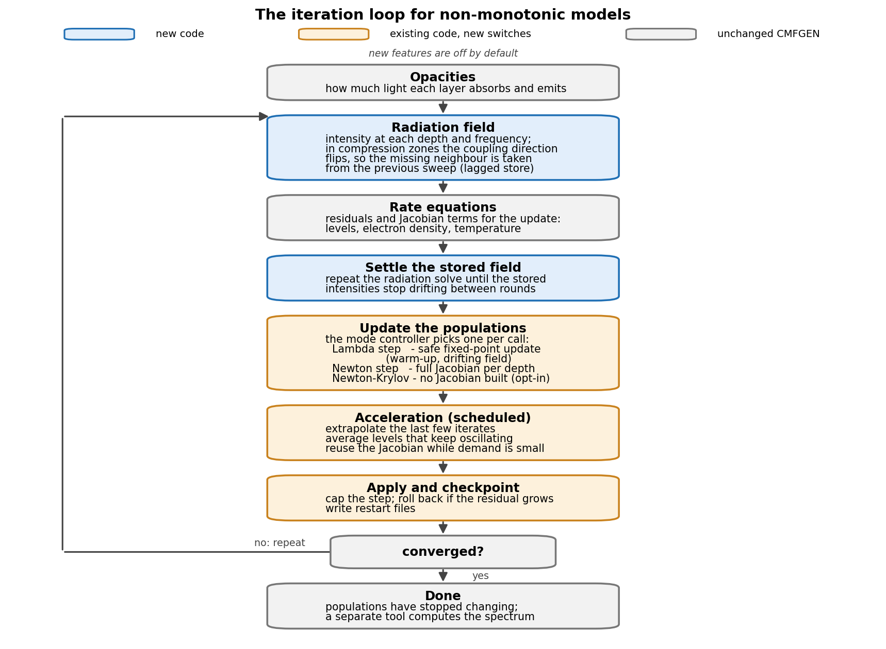
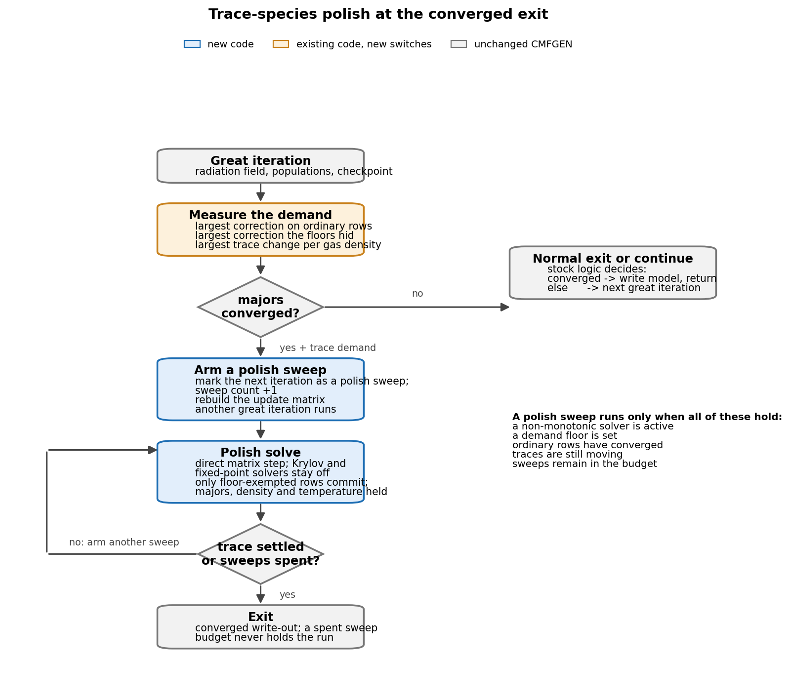

# CMFGEN with non-monotonic velocity fields and a Newton-Krylov population solve

Development fork of [CMFGEN](https://sites.pitt.edu/~hillier/web/CMFGEN.html)
(baseline `cur_cmf_18jun25`, `pitt-phyast/cmfsource`) for supernova
ejecta where the velocity law is not monotonic. The case we care about
is a Type IIn: a fast ejecta shell hits slow, dense circumstellar
material, and a reverse shock stalls the shell into a cold dense
shell. There `sigma = d ln V / d ln r` drops below -1, which the stock
code assumes cannot happen, so the transfer inside the compression
zone returns negative or NaN intensities.

The non-monotonic and Newton-Krylov solver paths are opt-in. With
their flags unset, they do not replace the stock solver. This tree
also has general correctness, build, and observation-frame fixes, so
it is not a byte-for-byte copy of upstream.


## The problem

CMFGEN alternates between a formal solution of the radiation field
and an update of the level populations, electron density, and
temperature. Two linear systems carry the iteration:

- The **transfer matrix**. In the comoving frame the intensity along a
  ray obeys an equation containing a frequency-shift term
  `gamma * dI/d ln nu`, with `gamma = (V/r)(1 + sigma*mu^2)`.
  Discretised on the frequency grid, this gives a matrix that is
  tridiagonal in frequency at each depth point. In homologous
  expansion `gamma > 0` everywhere, so each frequency couples only to
  the previous (bluer) one and the system sweeps outward in a fixed
  order. Lines in the expansion opacity can also be treated in the
  Sobolev approximation: each line meets the radiation field at
  exactly one resonance point per ray, where the optical depth is
  proportional to `1/(1 + sigma*mu^2)`.

- The **rate matrix** (the BA matrix in the code). At each depth, the
  statistical-equilibrium equations for the level populations plus the
  charge and energy equations form a dense `NT x NT` block. The stock
  update alternates fixed-point Lambda iterations with a Newton step
  on this block (`SOLVEBA`), whose largest demanded correction feeds
  the convergence metric.

Both break in an interacting supernova. When the flow decelerates into
a dense shell, `sigma` falls below -1 in the compression zone. The
comoving-frame frequency then folds back along a ray: one line
resonates at several points, `gamma` changes sign, and the upwind
direction of the frequency coupling reverses. A scheme hard-wired for
expansion pulls intensity from the wrong (uncomputed) neighbour, and
the Sobolev optical depth goes through a singularity at `gamma = 0`.
The second failure is in the population update: on a stalled model
the first full Newton step asks for order 1e7 per cent corrections,
mostly on physically empty trace levels that no step can satisfy.

## What the solver does


The formal solver follows Knop, Hauschildt & Baron (2009): the sign of
`gamma` picks which side counts as upwind. Expanding points couple to
the previous frequency, compressing points to the next one. The next
frequency has not been computed yet on the downward sweep, so its
intensity is stored and lagged by one iteration, kept only where
`sigma < -1`. This keeps the modified opacity positive and removes the
negative intensities.

A second, lighter path applies the Dessart, Audit & Hillier (2015)
Sobolev treatment directly in the compression zone: the unclamped
`sigma` drives the line opacity, and the optical-depth denominator is
floored so it cannot cross zero. Both paths are off by default.

## Iteration cycle




Each pass is one model iteration: solve the radiation field, update
the populations, write a checkpoint, repeat until the populations stop
changing. Grey boxes are stock CMFGEN, blue are new code, amber are
existing routines with new switches. Everything new is off by default.

The new parts:

- The non-monotonic formal solver. In compression zones a point's
  intensity couples to last iteration's stored value instead of the
  next frequency.
- A refresh loop that re-solves the radiation field until the lagged
  values stop moving, so the populations are never updated against a
  stale field.
- A mode controller that keeps the model on safe fixed-point steps
  until the lagged field settles, then switches to the faster Newton
  or Newton-Krylov step.
- Checkpoints of the lagged fields, so a restart picks up where it
  stopped.

## Updated approach: demand floors and the trace polish




On interacting-supernova models many levels are physically empty at
some depths (a few 1e-20 or less of the local gas). They keep
demanding large relative corrections that no solver can satisfy -
cascade coupling refills them between solves - so the convergence
metric never drops below the exit threshold and the model stalls at
the finish.

This tree treats those rows as trace species and handles them in two
stages, both off by default:

1. **Demand floors.** An absolute population floor and a relative
   floor (fraction of the largest population at the depth) exempt
   trace rows from the convergence metric. Their corrections still
   commit - the floors only gate the metric. The largest exempted
   demand and the largest committed trace change are reported every
   call, on both the stock and Newton-Krylov solve paths, so hidden
   demand is never silent.

2. **Trace polish sweeps.** When the major species converge but
   exempted rows are still moving, the run arms a polish phase and
   loops for a bounded number of extra iterations instead of exiting.
   Each sweep takes a direct matrix step, commits only the exempted
   rows, and holds the majors, electron density, and temperature
   fixed. Trace species are one-way coupled - they absorb and emit but
   do not feed back on the field or the majors - so solving them at a
   fixed major state is the lower triangle of a block-triangular
   system and cannot oscillate against the majors.

The run exits when the trace motion falls below its threshold or the
sweep budget runs out; a spent budget never holds the run. What
remains is the unsatisfiable dead-stage class the floors were built
for.

The exit test itself gates on the demanded correction, not the applied
step, so a capped or held update cannot release the exit while demand
remains. The test is evaluated before the final-iteration branch, so a
run whose iteration budget ends exactly on a converged state still
gets the convergence check and a report of which exit it took - clean
convergence, a saturated exempted demand, or a spent polish budget -
rather than writing out untested.

## Newton-Krylov population solve

The stock update alternates fixed-point iterations with a Newton step
on the depth-block rate matrix. On a stalled non-monotonic model that
step overshoots. The opt-in Krylov path treats statistical equilibrium
as `F(n) = 0` and solves it with GMRES - finite-difference
Jacobian-vector products, the rate matrix as preconditioner only
(Knoll & Keyes 2004; Arramy et al. 2024). Options allow a frozen or
recomputed radiation field during the residual evaluations, and the
lagged non-monotonic intensity store is held fixed for the duration of
each evaluation.

Each activation is bounded by iteration and restart caps plus two
budgets: `JFNK_MAX_EVALS` (residual evaluations) and `JFNK_MAX_SEC`
(wall-clock seconds per activation). Both default to 0, meaning off;
when `DO_JFNK` is set with no wall-clock budget the input reader
prints a warning that a stalled activation could consume the job.
Exhausting a budget forces the rejection path, so the iteration falls
back to the stock update rather than aborting.

## VADAT keys for the trace-exemption and polish machinery

All of these are opt-in and only take effect under
`DO_NONMONO_SOB`/`DO_NONMONO_KNOP` (or `DO_JFNK` where stated). With
the flags off none of this code runs and the defaults are inert.

| Key | Default | Meaning |
|---|---|---|
| `BA_DEM_PFLOOR` | -1 (auto) | Absolute population floor exempting trace rows from the demand metric. `-1` resolves to `1.0E-30` under the non-monotonic flags; `0` disables; `>0` is used as set. |
| `BA_DEM_RELFRAC` | -1 (auto) | Relative demand floor, as a fraction of the largest population row at the depth. `-1` resolves to `0.01` under the non-monotonic flags; `0` disables. |
| `BA_TR_MAXSWP` | 3 | Bound on Stage-B trace-polish sweeps. `0` disables the polish entirely; the reader no longer rewrites `0` to another value. |
| `BA_TR_ABSMAX` | 1.0E-08 | Trace convergence threshold on `BA_TR_ABS` (max committed `|dn|/POP_ATOM` over exempted rows). Under the non-monotonic flags an explicit `0` is auto-set to `1.0E-08`. |
| `KN_ADAPT_RELAX` | T | Adaptive write-back weight for the lagged-field refresh maps (`INEXT_RELAX`/`JNEXT_RELAX` adapt to the measured contraction). `F` keeps the fixed `0.5` weight. |
| `GS_RAW_MATURE` | F | `T` requires the raw FG sweep max change to pass `GS_MATURE_TOL` for a sweep to count toward the `GS_REL_STABLE` release streak -- a bulk-pass sweep with a high max norm resets the count instead. Recommended for KNOP runs. |
| `JFNK_CPL_RELWAIT` | F | `T` defers the coupled JFNK tier while a call sits in the post-release damp window (`N_REL_SINCE <= GS_REL_N`); the call falls to the frozen tier or SOLVEBA. Note: a very large `GS_REL_N` defers the coupled tier indefinitely. |
| `JFNK_REL_REACH_MAX` | 5 | Consecutive reach-gate skips after which the SOB stable-LAMBDA relief stands down (stops relaxing `JFNK_GATE_NREQ`). `0` disables the stand-down. |
| `JFNK_FD_COS_MIN` | 0.05 | Descent floor on the finite-difference image of the clipped step, `cos(F,A_FD z)` -- the stored-BA REACH can pass a step the true Jacobian maps anti-parallel to F (KNOP_jfnkrel it35: REACH 0.735 vs FD cos -0.23). `0` disables. |
| `JFNK_FD_AUTODEF` | T | Defer any JFNK admission whose FD operator image is anti-descent (`cos(F,A_FD z) < 0`), even with all thresholds at 0. Arms the precheck block (one extra residual eval per admission). `F` recovers pre-guard behaviour. |
| `LUM_DIV_FAC` | 1.0E2 | KNOP only: per-call outer-luminosity growth factor counted as runaway. |
| `LUM_DIV_N` | 3 | KNOP only: consecutive runaway calls before `LUM_BLOCKED` fires (pops held, damped LAMBDA only). `0` disables the guard. |
| `LUM_DIV_CAP` | 1.0E15 | KNOP only: outer luminosity (L_sun) past which the run stops as non-convergent. |

Observation-frame (`cmf_flux`/`obs_frame`) keys:

| Key | Default | Meaning |
|---|---|---|
| `ALLOW_SIGMA_UNDEF` | F | `T` warns instead of aborting on cells with an undefined `SIGMA_TRUE`. |
| `SOB_SIGMA_MAX` | -1 (off) | If `>0`, clamp `|SIGMA_TRUE|` to this bound in the OBS estimator. Off keeps the same unclamped `SIGMA_TRUE` as the population solve. |

## Validation status

The Newton-Krylov path is off by default. Admission waits for a warmup
window, a mature and stable radiation field, and contracting matrix
demand; it is not triggered by a single low correction. A clean build
or a generated spectrum alone does not establish that the new paths
converge or produce a valid interacting-supernova spectrum.

## Changes vs upstream

Solver behaviour is gated where stated; the tree also contains general
correctness and build fixes that are not controlled by solver flags:

- Non-monotonic Sobolev line treatment in compression zones, after
  Dessart, Audit & Hillier (2015). The unclamped velocity gradient is
  carried in the restart files and recomputed on restart.
- The Knop et al. (2009) formal solver with the lagged-intensity
  machinery, and a moment-equation variant for the same fields.
- A Jacobian-free Newton-Krylov population solve that replaces the
  stock Newton step on admitted iterations.
- Residual-based acceptance for Newton steps, including rollback of
  only the failed depth columns when the bulk residual remains
  acceptable, and a bound on repeated rejected steps.
- Per-equation quarantine for equation/depth pairs that fail
  repeatedly; fixed-point iterations still update those populations.
- Watchdog, checkpoint, and restart handling for the lagged-field
  state across job requeues.
- Rejection of inconsistent line-treatment settings by the input
  readers instead of running with mixed transfer assumptions.
- General fixes including the non-monotonic observed-frame
  integration bounds and headless build support.

## Building and running

```bash
module load intel mkl
./build.sh          # production build: main code + spectrum tools
./build_debug.sh    # bounds-checked debug build of the main code
```

The production build produces the model executable plus the flux and
observed-frame tools. All new behaviour is switched off unless the
corresponding input-file options are set; see `AGENTS.md` for the
build constraints and verification checklist.

## References

- Knop, Hauschildt & Baron 2009, *A&A* 496, 295,
  "A new formal solution of the radiative transfer in arbitrary
  velocity fields" - the `chi_hat` formulation.
  [DOI](https://doi.org/10.1051/0004-6361:200810290) |
  [ADS](https://ui.adsabs.harvard.edu/abs/2009A%26A...496..295K) |
  [arXiv:0902.1876](https://arxiv.org/abs/0902.1876)
- Knop, Hauschildt & Baron 2009, *A&A* 501, 813,
  "Comoving-frame radiative transfer in arbitrary velocity fields -
  II. Large scale applications" - the Gauss-Seidel solvers.
  [DOI](https://doi.org/10.1051/0004-6361/200911793) |
  [ADS](https://ui.adsabs.harvard.edu/abs/2009A%26A...501..813K)
- Dessart, Audit & Hillier 2015, *MNRAS* 449, 4304,
  "Numerical simulations of superluminous supernovae of type IIn" -
  the interaction model the Sobolev branch follows.
  [DOI](https://doi.org/10.1093/mnras/stv609) |
  [ADS](https://ui.adsabs.harvard.edu/abs/2015MNRAS.449.4304D) |
  [arXiv:1503.05463](https://arxiv.org/abs/1503.05463)
- Feldmeier & Nikutta 2006, *A&A* 446, 661,
  "Nonlocal radiative coupling in non monotonic stellar winds" -
  three-point coupling across velocity kinks.
  [DOI](https://doi.org/10.1051/0004-6361:20053380) |
  [ADS](https://ui.adsabs.harvard.edu/abs/2006A%26A...446..661F)
- Knoll & Keyes 2004, *J. Comput. Phys.* 193, 357,
  "Jacobian-free Newton-Krylov methods: a survey of approaches and
  applications" - the JFNK method and pseudo-transient continuation.
  [DOI](https://doi.org/10.1016/j.jcp.2003.08.010)
- Arramy, de la Cruz Rodriguez & Leenaarts 2024, *A&A* 690, A12,
  "Jacobian-Free Newton-Krylov method for multilevel NLTE radiative
  transfer problems" - JFNK on NLTE populations; the convergence
  requirements the solver here follows.
  [DOI](https://doi.org/10.1051/0004-6361/202449963) |
  [arXiv:2406.17234](https://arxiv.org/abs/2406.17234)
