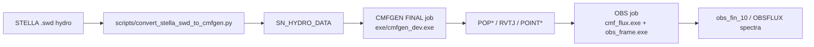

# Model pipeline

How a snapshot becomes a converged CMFGEN model and a spectrum.

## Chain



- Configs: `SN2024pba/configs/*.yaml` (e.g.
  `dessart_m15_2p82d_JFNK_hyb.yaml`, `dessart_m15_2p82d_SOB.yaml`).
- Orchestrator: `scripts/run_model_grid.py` - resolves the model dir,
  writes `VADAT`/`IN_ITS`/`CMF_FLUX_PARAM`/slurm scripts via
  `cmfgen_base*/submit_cmfgen.sh` + `prepare_VADAT.py`, submits FINAL,
  submits a convergence monitor `after:<FINAL>`, and chains OBS
  `afterok`.
- The monitor runs `scripts/check_convergence.py --plot
  CONVERGENCE_HISTORY.PNG` every 30 s, then writes one final plot after
  FINAL leaves the queue. On Viper it inherits the model partition; APU
  monitor jobs need `--account=mpe_apu --qos=a0004 --gres=gpu:1`. The
  generated CMFGEN job also carries a best-effort in-job 30 s plot loop.
- `cmfgen_jfnk/build.sh` builds `make DEBUG=nodebug all`, not just the
  `cmfgen` target. It uses `KEEP_EXE=1 clean`, so the previous
  executables remain installed during compilation and production links
  publish via a temporary name plus `mv`.
- Never submit raw `sbatch`; the workflow wraps resubmission, restart
  file preservation, stall detection, and OUTGEN fatal-pattern checks.

## Non-monotonic activation (a real gotcha)

`non_mono_mode: KNOP` (or `SOB`) alone does **not** open the
orchestrator's non-monotonic block. The block fires only if a
`DO_NOMONO_*` / `NON_MONO_SOLVER` key is set `T` in
`cmfgen.vadat_overrides` (run_model_grid.py ~L8126). Working configs
therefore carry the pair:

```yaml
non_mono_mode: KNOP
vadat_overrides:
  DO_NOMONO_KNOP: T    # pipeline-side activator (V6-style name)
  DO_NONMONO_KNOP: T   # the flag the Fortran actually reads
```

(SOB likewise needs `DO_NOMONO_SOB` + `DO_NONMONO_SOB`.) If the block
does not open, `GLOBAL_LINE` gets stamped `BLANK` and the forced key
table never lands - check `config_resolved.yaml` / the written VADAT.

## CMF_FLUX OBS status for Knop populations

The Knop population solver remains available in the CMFGEN pipeline, but
this tree's `cmf_flux` OBS executable was returned to the stock CMFGEN
formal-solver path on 13-Oct-2026. It no longer has the non-monotonic
Knop OBS formal-J branch. `prepare_CMF_PARAM.py` rejects a Knop population
snapshot at OBS preparation rather than silently making a spectrum with
a mismatched continuum solution. Do not treat a Knop population run as a
complete spectral product until that OBS path is deliberately restored
and validated.

## OBS render modes for SOB populations (`obs_line_treatment`)

`prepare_CMF_PARAM.py` selects the OBS render. For SOB populations the
default is the resolved Sobolev render:

| `obs_line_treatment` | `GLOBAL_LINE`/`TRANS_*` | `DO_SOB_LINES`/`SOB_FREQ_IN_OBS` | `DO_SOB_FLUX_OBS` | Product |
|---|---|---|---|---|
| `sob` (default) | `SOB` | `T`/`T` | `T` | resolved profile: inject Sobolev line opacity/emissivity as Doppler cores into the stored CMF arrays (`ADD_SOB_LINE_PROF`), then render with a second `OBS_FRAME_SUB_V9` pass |
| `sob_ew` | `SOB` | `T`/`T` | `F` | EWDATA diagnostic only; spectrum stays continuum-only |
| `blank` | `BLANK` | `F`/`F` | - | stock CMF line profiles as a comparison render for SOB populations; it does not select a non-monotonic formal-J solver |

The flux-mode keys are not mirrored from VADAT (they are inert in the
SE solve); the line-treatment keys `GLOBAL_LINE`/`TRANS_*`/`DO_*SOB*`/
`LAM_SET` are. `DO_SOB_FLUX_OBS=T` requires `DO_NONMONO_SOB=T`,
`DO_SOB_LINES=T`, and `SOB_FREQ_IN_OBS=T`; the reader STOPs otherwise.
See [[Sobolev non-mono solver]] for the injection algorithm and its
limits on non-monotonic fields.

## Pipeline defaults (in scripts/, post-dev7)

- `ADJUST_CORRECTIONS`, `IT_SPECIFIER`, `table*.dat` excluded from run
  dirs (opt-in only) - a `REV_RGRID=T` run without them fails loudly.
- Grid adjustments off: `REV_RGRID=F`, `N_OB_INS=0` - the initial
  `SN_HYDRO_DATA` arrives pre-optimized.
- `IT_ON_T=F` - **important**: with `LSTAR=0` the grey-T re-estimate
  collapses T to the 0.95*T_MIN floor before iteration 1 and wrecks
  the start. See AGENTS.md "Why IT_ON_T must stay off for LSTAR=0".
- `FIX_NE=F` - CMFGEN solves Ne from charge conservation rather than
  pinning the rough hydro Saha estimate.
- CMFGEN production jobs default to 16 CPUs (`CMFGEN_PROD_CPUS`);
  interactive/debug partition caps at the QOS max 16, mem <= ~31G.
- `cmfgen.do_gt_auto` YAML controls `DO_GT_AUTO` in IN_ITS.
- `cmfgen.rdinr_ib_ins` / `cmfgen.rdinr_ob_ins` (+ `rdinr_bnd_ratio`,
  default 2.5) opt-in RDINR-side boundary refinement: geometric log-R
  splitting of the innermost/outermost cell, finest sub-cell at the
  boundary. This restores Luc's `N_IB_INS`/`N_OB_INS` scheme from
  `SET_SN_R_GRID` (fractions ~0.039/0.137/0.384 vs his 0.06/0.16/0.4),
  which is dead under `RD_IN_R_GRID=T` because that mode reads RDINR
  verbatim. Applied inside `write_rdinr` after `target_nd` downsampling
  and `rdinr_max_dv_kms` refinement, so MODEL_SPEC `ND` follows
  `nd_written` automatically; CMFGEN re-derives V/SIGMA from the
  SN_HYDRO_DATA spline at each inserted radius. Wired as
  `--rdinr-ib-ins/--rdinr-ob-ins/--rdinr-bnd-ratio` through
  `run_model_grid.py`, `submit_cmfgen.sh` and `prepare_VADAT.py`, with
  a YAML fallback in `prepare_VADAT` so a pending job picks up config
  edits on regeneration (13-Oct-2026).
- Restart-files preserve list includes `POINT1/2`, `POP*`,
  `FGINEXT_GS`, `MOMJNXT_GS`, `VADAT` (see
  [[Checkpoints and state files]]) - added after an OBS-only resubmit
  wiped a run dir and produced the INDEXX segfault.

## SLURM mechanics that matter

- **Requeue**: `submit_cmfgen.sh` requeues on graceful stop;
  `file_requeue_count>0` triggers the `COMP_F` flip so restarted
  segments reuse persisted Eddington factors instead of re-Lambda-
  iterating them (previously each requeue zeroed the scattering J at
  freq 1).
- **Warm restart**: POINT1/2 carry R,V,SIGMA,POPS;
  `FGINEXT_GS`/`MOMJNXT_GS` carry the lagged coupling stores; see
  [[Checkpoints and state files]].
- **Stall watchdog**: generated slurms read `GS_STATE` each segment;
  `KNOP_STALL_MAX` (default 60) consecutive frozen iterations blocks
  requeue and drops `.CMFGEN_KNOP_STALLED`.
- **Fatal scan**: `check_outgen_for_fatal` greps OUTGEN; the exclusion
  list must cover benign `NaN` diagnostic lines (the MOM
  `capped/NaN writes= 0` line needed an explicit exclusion).
- The JFNK lagged store is **process-local and re-zeroed on requeue** -
  `N_LAM_RWARM` forced-Lambda warmup exists precisely for this; a
  mature `FGINEXT_GS` checkpoint (`GS_RWARM_SKIP`) skips it.

## Related

- [[Build and git workflow]]
- [[VADAT keys]]
- [[Checkpoints and state files]]
